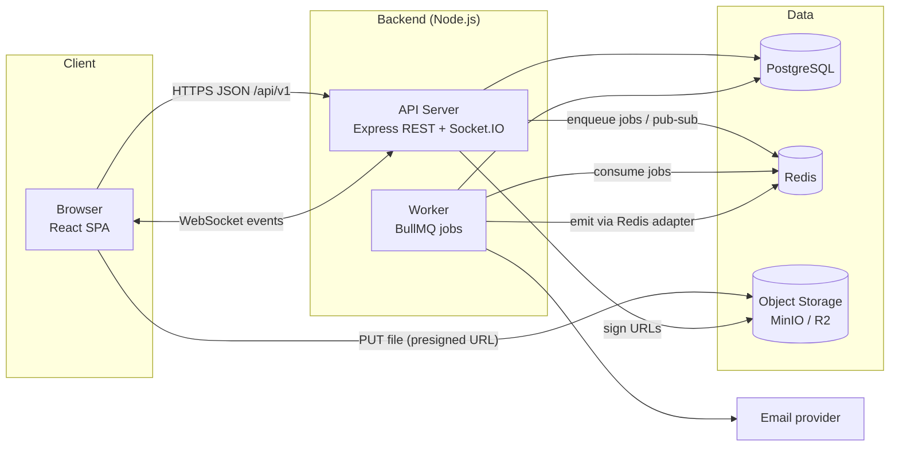
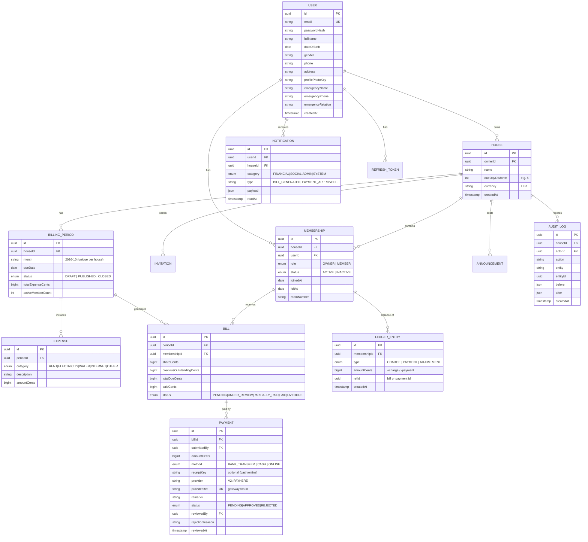
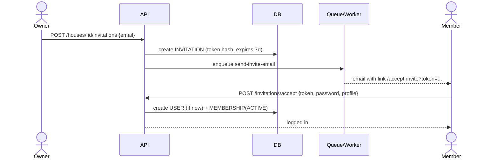
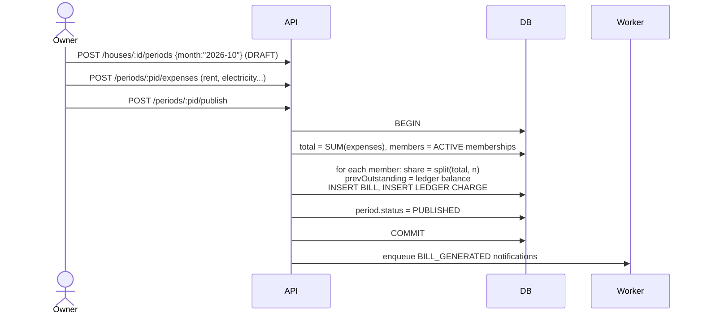
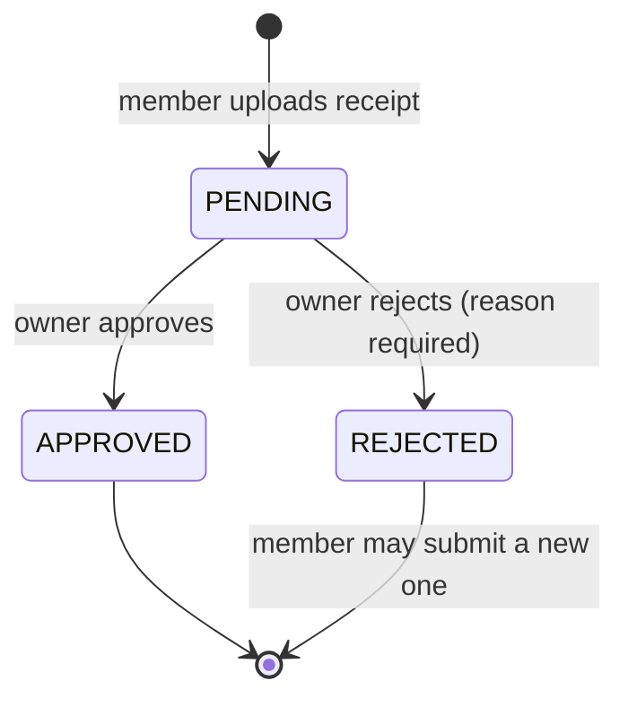
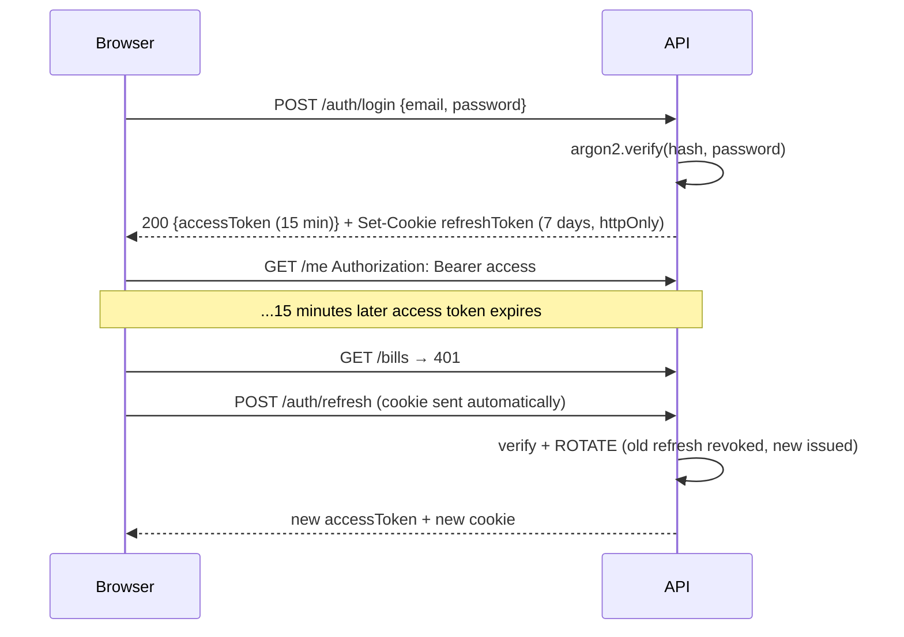
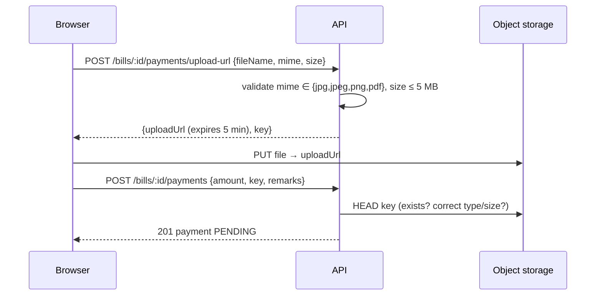

# BoardMate — System Architecture

> **Version:** 0.1 (Design phase) · **Source of requirements:** `docs/srs/Software_Requirements_Specification.pdf`
>
> This document explains **what** we are building, **why** each decision was made, and **how** the parts talk to each other.
> Every section ends with an **🎯 Interview angle** box: the questions an interviewer is likely to ask about it, and the short answer.

---

## Table of contents

1. [What is BoardMate?](#1-what-is-boardmate)
2. [Architecture style](#2-architecture-style)
3. [Tech stack and why](#3-tech-stack-and-why)
4. [High-level system diagram](#4-high-level-system-diagram)
5. [Repository layout (monorepo)](#5-repository-layout-monorepo)
6. [Backend architecture (layers)](#6-backend-architecture-layers)
7. [Frontend architecture](#7-frontend-architecture)
8. [Data model (database design)](#8-data-model-database-design)
9. [Core business flows](#9-core-business-flows)
10. [Money handling rules](#10-money-handling-rules)
11. [Authentication and authorization](#11-authentication-and-authorization)
12. [API design](#12-api-design)
13. [Background jobs and scheduling](#13-background-jobs-and-scheduling)
14. [Real-time notifications](#14-real-time-notifications)
15. [File storage (receipts)](#15-file-storage-receipts)
16. [Error handling, validation and logging](#16-error-handling-validation-and-logging)
17. [Testing strategy](#17-testing-strategy)
18. [Environments, DevOps and CI/CD](#18-environments-devops-and-cicd)
19. [Mapping NFRs to design](#19-mapping-non-functional-requirements-to-design)
20. [Version 2 readiness](#20-version-2-readiness)
21. [Glossary](#21-glossary)

---

## 1. What is BoardMate?

A web application that helps **boarding house owners** manage members, monthly shared expenses, bills, payments and communication — and lets **members** see their dues, upload payment receipts and get notifications.

| Actor | Main goals |
|---|---|
| **Owner** | Create houses, invite/manage members, enter monthly expenses, publish bills, verify receipts, see reports, post announcements |
| **Member** | See current due and balance, upload receipts, track history, get notifications and birthday reminders |
| **System (scheduler)** | Mark bills overdue, send due reminders, send birthday notifications |

**Key constraint (V1):** money is paid *outside* the system (bank transfer, cash). BoardMate **records and verifies** — it never moves money.

---

## 2. Architecture style

**Choice: a modular monolith with a separate SPA frontend, organised as a monorepo.**

```
 Browser (React SPA)  ──HTTPS/JSON──▶  API server (Node/Express, one deployable)
                       ◀─WebSocket──            │
                                                ├── PostgreSQL (data)
                                                ├── Redis (job queue, cache, socket adapter)
                                                └── Object storage (receipt files)
                                       Worker process (same codebase, runs jobs)
```

### Why not microservices?

| | Modular monolith ✅ | Microservices |
|---|---|---|
| Team size | Fits 1–5 devs | Needs many teams |
| Deployment | One app (+1 worker) | Many services, service discovery |
| Transactions | One DB transaction can update bill + payment + ledger safely | Needs sagas / eventual consistency |
| Debugging | One log stream, one stack trace | Distributed tracing required |
| Future | Modules have clean boundaries → **can be extracted later** | Already split |

The important word is **modular**: code is split into feature modules (`auth`, `houses`, `members`, `billing`, `payments`, `notifications`, …). Modules only talk to each other through their **service** interface, never by reaching into another module's database queries. That keeps the option to split into services later.

### Why separate API and worker processes?
The API must answer requests fast. Slow or scheduled work (sending 500 reminders, generating bills, emails) runs in a **worker** process that reads jobs from Redis. If the worker crashes, the API stays up, and jobs are retried.

> 🎯 **Interview angle**
> - *"Monolith vs microservices?"* → Start with a modular monolith; you get simple deployment and ACID transactions. Split only when team size or scaling needs demand it.
> - *"What does 'modular' mean in your project?"* → Feature folders with their own routes/controller/service/repository; cross-module calls only through services.

---

## 3. Tech stack and why

| Layer | Choice | Why this (and not the alternative) |
|---|---|---|
| Language | **TypeScript** (front + back) | Type safety catches bugs at compile time; one language across the stack; shared types between API and UI. Most job ads now ask for TS, not plain JS. |
| Frontend | **React 18 + Vite** | React is the most-hired UI library. Vite gives instant dev server (native ES modules) vs slow Webpack/CRA (CRA is deprecated). |
| Routing | **React Router** | Standard for SPAs. |
| Server state | **TanStack Query** | Caching, refetching, loading/error states for API data. Avoids putting server data in Redux. |
| Client state | **Zustand** | Tiny global store for auth/UI state. Less boilerplate than Redux. |
| Forms | **React Hook Form + Zod** | Fast, uncontrolled forms; Zod schemas shared with backend → same validation rules on both sides. |
| UI | **Tailwind CSS + shadcn/ui** | Utility CSS, responsive by default (NFR: mobile-friendly); shadcn gives accessible components you own. |
| Backend | **Node.js 22 LTS + Express 5** | Most common Node framework; we build the structure ourselves so you *understand* layering, middleware and DI (NestJS hides this — you can learn it later easily). |
| Validation | **Zod** | Runtime validation of requests + TS types inferred from the same schema. |
| Database | **PostgreSQL 16** | Money data must be **ACID**: a payment approval updates several rows that must succeed or fail together. Relational data (house → members → bills → payments) fits SQL perfectly. Strong constraints (FK, CHECK, UNIQUE). |
| ORM | **Prisma** | Type-safe queries, schema-as-code, versioned **migrations**. |
| Queue / scheduler | **Redis + BullMQ** | Reliable delayed + repeatable jobs with retries (overdue checks, reminders, birthdays). Cron inside the API would run twice if we scale to 2 instances — BullMQ prevents that. |
| Real-time | **Socket.IO** | WebSocket with fallback, rooms per user/house, Redis adapter for multi-instance. |
| File storage | **S3-compatible** (MinIO locally, Cloudflare R2 / AWS S3 in prod) | Never store files in the DB or on the server disk (lost on redeploy, doesn't scale). Presigned URLs = browser uploads directly to storage. |
| Email | **Nodemailer** (Mailpit locally, Resend/SES in prod) | Invitations, password reset, important notices. |
| Auth | **JWT access token + rotating refresh token (httpOnly cookie)**, **argon2** password hashing | Stateless API auth, safe against XSS token theft; argon2 is the modern recommended hash. |
| Logging | **pino** | Fast structured JSON logs with request IDs. |
| API docs | **OpenAPI (Swagger) generated from Zod** | Docs never drift from code. |
| Testing | **Vitest**, **Supertest**, **Playwright** | Unit, API integration, end-to-end. |
| Tooling | **pnpm workspaces**, ESLint, Prettier, Husky + lint-staged, Commitlint | Industry hygiene: consistent code, conventional commits. |
| Containers | **Docker + Docker Compose** | Same Postgres/Redis/MinIO on every machine with one command. |
| CI/CD | **GitHub Actions** | Lint → typecheck → test → build on every PR. |

> 🎯 **Interview angle**
> - *"Why PostgreSQL and not MongoDB?"* → Financial data needs multi-row ACID transactions, foreign keys and strict schema. Our data is highly relational. Mongo is great for flexible documents, but we'd fight it here.
> - *"Why TanStack Query and Zustand instead of Redux?"* → Separate **server state** (cached copy of DB data) from **client state** (UI/auth). Each tool does one job well.
> - *"Why a queue instead of setInterval/cron?"* → Persistence, retries, no duplicate runs across instances, the API stays responsive.

---

## 4. High-level system diagram



**Request path in words (where → where):**
1. Browser calls `GET /api/v1/houses/:houseId/bills` with `Authorization: Bearer <accessToken>`.
2. Express middleware chain: request-id → logger → CORS/helmet → rate-limit → **auth** (verify JWT) → **authorize** (is this user owner/member of that house?) → **validate** (Zod).
3. **Controller** reads the validated input and calls the **service**.
4. **Service** applies business rules and calls the **repository**.
5. **Repository** runs the Prisma query against PostgreSQL.
6. Result flows back; controller sends JSON `{ data, meta }`.
7. Any thrown error is caught by the **global error handler** → consistent JSON error.

---

## 5. Repository layout (monorepo)

```
BoardMate/
├── apps/
│   ├── api/                 # Express API + worker (Node/TS)
│   └── web/                 # React SPA (Vite/TS)
├── packages/
│   └── shared/              # Zod schemas, enums, types, money utils used by BOTH apps
├── infra/
│   └── docker/              # docker-compose for Postgres, Redis, MinIO, Mailpit
├── docs/
│   ├── ARCHITECTURE.md      # this file
│   ├── adr/                 # Architecture Decision Records (one decision per file)
│   ├── LEARNING_ROADMAP.md  # build phases + what you learn in each
│   └── srs/                 # the SRS document
├── .github/workflows/       # CI pipelines
├── package.json             # root scripts (pnpm workspaces)
└── pnpm-workspace.yaml
```

**Why a monorepo?** API and UI share the **same Zod schemas and types** from `packages/shared`. Change a field once → TypeScript shows every place in front and back that must be updated. One PR can change API + UI together. One CI pipeline.

> 🎯 *"Monorepo vs polyrepo?"* → Monorepo when apps are developed by the same team and share code; polyrepo when teams/release cycles are independent.

---

## 6. Backend architecture (layers)

### 6.1 Folder structure (`apps/api/src`)

```
src/
├── config/            # env loading + validation (Zod), constants
├── lib/               # infrastructure clients: prisma, redis, s3, mailer, logger, socket
├── middlewares/       # auth, authorize, validate, error-handler, rate-limit, request-id
├── modules/           # ← FEATURES (vertical slices)
│   ├── auth/
│   │   ├── auth.routes.ts       # URL → middleware → controller
│   │   ├── auth.controller.ts   # HTTP in/out only (req, res)
│   │   ├── auth.service.ts      # business logic (no req/res!)
│   │   ├── auth.repository.ts   # DB access only
│   │   ├── auth.schemas.ts      # Zod request schemas
│   │   └── auth.test.ts
│   ├── users/
│   ├── houses/
│   ├── members/         # memberships, invitations, status
│   ├── expenses/
│   ├── billing/         # billing periods + bill generation + carry-forward
│   ├── payments/        # receipt submission + verification
│   ├── ledger/          # append-only money entries
│   ├── notifications/
│   ├── announcements/
│   ├── reports/         # dashboards + reports (read-only queries)
│   └── audit/
├── jobs/              # BullMQ queues, processors, schedulers
├── shared/            # errors (AppError), pagination, helpers
├── app.ts             # builds the Express app (no listen) → testable
├── server.ts          # starts HTTP + Socket.IO
└── worker.ts          # starts BullMQ workers
```

### 6.2 Why these layers?

| Layer | Knows about | Must NOT know about | Why |
|---|---|---|---|
| **Route** | URL, HTTP verb, middleware order | business rules | One place to see the whole API surface |
| **Controller** | `req`, `res`, status codes | SQL, Prisma | Thin; translates HTTP ↔ function call |
| **Service** | business rules, transactions, other services | `req`/`res` | Reusable from HTTP, jobs, tests, CLI |
| **Repository** | Prisma/SQL | HTTP, business rules | Swap/optimise queries without touching logic |

This is the **Separation of Concerns** and **Single Responsibility** principles. Services receive dependencies (repositories, other services) through constructor/factory parameters — **Dependency Injection** — so tests can pass fakes.

### 6.3 Example: life of "Owner approves a payment"

```
PATCH /api/v1/houses/:houseId/payments/:paymentId/approve
  → auth middleware        (who are you?)
  → authorize('OWNER')     (are you the owner of THIS house?)
  → validate(params)       (are ids valid UUIDs?)
  → paymentsController.approve
  → paymentsService.approve(paymentId, actorId)
        BEGIN TRANSACTION
          lock payment row; must be PENDING
          payment.status = APPROVED, reviewedBy, reviewedAt
          ledger.insert(PAYMENT credit)
          bill.paidAmount += amount; bill.status recalculated
          audit.insert(PAYMENT_APPROVED)
        COMMIT
        enqueue notification job (after commit!)
  → 200 { data: payment }
```

> 🎯 **Interview angle**
> - *"Why keep controllers thin?"* → Logic in services can be reused by jobs and tested without HTTP.
> - *"Why enqueue the notification after commit?"* → If the transaction rolls back, we must not tell the member it was approved. (Advanced: *transactional outbox* pattern.)
> - *"What is DI and why use it?"* → Pass dependencies in instead of importing them directly → loose coupling, easy mocking.

---

## 7. Frontend architecture

### 7.1 Folder structure (`apps/web/src`)

```
src/
├── app/               # App root: providers (QueryClient, Router, Theme), route config
├── pages/             # Route-level screens (thin – compose features)
├── features/          # ← FEATURES, mirrors backend modules
│   ├── auth/          #   api.ts (calls), hooks.ts (useLogin…), components/, schemas
│   ├── houses/
│   ├── members/
│   ├── billing/
│   ├── payments/
│   ├── notifications/
│   └── dashboard/
├── components/        # Shared, dumb UI components (Button, Modal, DataTable)
├── layouts/           # OwnerLayout, MemberLayout, AuthLayout
├── lib/               # axios instance + interceptors, socket client, queryClient
├── stores/            # Zustand stores (auth session, UI)
├── hooks/             # generic hooks (useDebounce, useMediaQuery)
├── utils/             # formatters (formatLKR, dates)
└── main.tsx
```

### 7.2 Key decisions
- **Feature-based folders** (not "all components in one folder") → when you work on payments, everything is in `features/payments`.
- **Server state = TanStack Query.** After approving a payment we `invalidateQueries(['bills', houseId])` → lists refetch automatically.
- **Access token in memory** (Zustand), **refresh token in httpOnly cookie**. An axios interceptor catches `401`, calls `/auth/refresh` once, retries the original request.
- **Route guards:** `<RequireAuth role="OWNER">` wraps owner pages.
- **Socket events** → update the query cache / show a toast.
- **Responsive first** (NFR): Tailwind breakpoints; member UI designed for phones.

> 🎯 *"Where do you store JWTs in the browser and why?"* → Access token in memory (not localStorage → XSS-safe), refresh token in httpOnly+Secure+SameSite cookie (JS can't read it).

---

## 8. Data model (database design)

### 8.1 Entity-relationship diagram



### 8.2 Design decisions explained

| Decision | Why |
|---|---|
| **`USER` separate from `MEMBERSHIP`** | A person is a user once; they can belong to a house as member (and later move houses). Owner can own many houses (multi-tenant). Role is **per house**, not global. |
| **UUID primary keys** | Not guessable in URLs (`/payments/7` invites enumeration), safe to generate anywhere. |
| **Money as `BIGINT` cents** | See §10. Never floats. |
| **`BILLING_PERIOD` with DRAFT → PUBLISHED** | Owner can enter/correct expenses before members see bills. Publishing is the moment bills are generated. |
| **`BILL` stores a snapshot** (`shareCents`, `previousOutstandingCents`) | History must not change if someone edits a member later. Bills are documents. |
| **`PAYMENT` separate from `BILL`** | FR-09/10: many partial payments per bill, each with its own receipt and approval. |
| **`PAYMENT.method`** | BANK_TRANSFER (receipt + owner approval), CASH (recorded by owner, auto-approved), ONLINE (V2 gateway, approved by verified webhook). See ADR 0009. |
| **Append-only `LEDGER_ENTRY`** | Source of truth for balances: `balance = SUM(amount)`. Never updated or deleted → full audit (FR-20) and easy to reconcile. |
| **Soft delete via `status = INACTIVE`** | FR-04/FR-20: never delete records; inactive members are excluded from future billing but keep history. |
| **`AUDIT_LOG` with before/after JSON** | Who changed what, when — required for trust in money apps. |
| **Unique constraints** | `(houseId, month)` on periods, `(periodId, membershipId)` on bills → prevents double billing even if a button is clicked twice. |
| **Indexes** | `bill(status, periodId)`, `payment(status, billId)`, `notification(userId, readAt)`, `user(dateOfBirth)` for fast dashboards (<3 s NFR). |

> 🎯 **Interview angle**
> - *"How do you prevent duplicate bills?"* → DB unique constraint + idempotent generation inside a transaction. App checks alone are not enough (race conditions).
> - *"Soft delete vs hard delete?"* → Soft for anything financial/auditable; hard only for truly disposable data.
> - *"What is normalisation? Did you denormalise anywhere?"* → Yes: bills snapshot amounts and periods store `totalExpenseCents` for fast reads and historical accuracy.

---

## 9. Core business flows

### 9.1 Owner onboarding a member (invitation)



### 9.2 Monthly billing (FR-05, 06, 07)



**Carry-forward (FR-07)** comes naturally from the ledger: the member's balance before the new charge **is** the previous outstanding (e.g. Rs 1,000). New bill: `totalDue = share (6,000) + previousOutstanding (1,000) = 7,000`.

### 9.3 Payment submission and verification (FR-08 → FR-12)



**Bill status** is *derived* after every change:

| Condition (checked in order) | Bill status |
|---|---|
| `paid >= totalDue` | **PAID** |
| any payment PENDING | **UNDER_REVIEW** |
| `paid > 0` and today > dueDate | **OVERDUE** |
| `paid > 0` | **PARTIALLY_PAID** |
| today > dueDate | **OVERDUE** |
| otherwise | **PENDING** |

> REJECTED is a **payment** status (FR-12 lists it; we show it on the payment, and the bill returns to its previous state).

---

## 10. Money handling rules

1. **Store integer cents** (`BIGINT`). `0.1 + 0.2 !== 0.3` in JavaScript floating point. Rs 6,000.50 → `600050`.
2. **Fair split with remainder:** Rs 10,000.00 / 3 members = 333333.33… cents.
   `base = floor(total / n)`, `remainder = total % n` → the first `remainder` members (ordered by join date) pay +1 cent. Total always matches exactly.
3. **All money changes happen inside a DB transaction** with row locks (`SELECT … FOR UPDATE`) so two approvals at the same time cannot double-count.
4. **Validation:** payment amount > 0; cannot exceed outstanding by more than a configured tolerance (prevents typos).
5. **Formatting only at the edge:** UI shows `Rs. 6,000.00` via `Intl.NumberFormat('en-LK', { style: 'currency', currency: 'LKR' })`.
6. Money utilities live in `packages/shared/money` and are **unit-tested heavily**.

> 🎯 *"How do you handle currency in code?"* → Integer minor units, never floats; split with remainder distribution; transactions + locking for concurrent updates.

---

## 11. Authentication and authorization

### 11.1 Authentication (who are you?)



- **Refresh token rotation + reuse detection:** stored as a *hash* in DB. If an old (already used) token is presented → someone stole it → revoke all sessions for that user.
- Password reset via single-use, expiring, hashed token sent by email.
- Rate limiting on `/auth/*` (brute-force protection).

### 11.2 Authorization (what can you do?)
**Role-based access control, scoped per house** (NFR: users access only authorised info).

```ts
router.patch('/houses/:houseId/payments/:id/approve',
  authenticate,               // valid JWT?
  requireHouseRole('OWNER'),  // membership(houseId, user).role === OWNER ?
  validate(approveSchema),
  controller.approve);
```
And inside services every query is **scoped by `houseId`** → a member of House A can never read House B even by guessing an id (prevents **IDOR**).

> 🎯 *"Authentication vs authorization?"* · *"Why short-lived access tokens?"* · *"What is IDOR and how did you prevent it?"* · *"bcrypt vs argon2?"*

---

## 12. API design

- **REST**, JSON, versioned: `/api/v1/...`
- **Nested by tenant:** `/api/v1/houses/:houseId/members`
- Plural nouns, HTTP verbs carry meaning; actions that aren't CRUD use sub-resources: `POST /periods/:id/publish`, `POST /payments/:id/approve`.
- **Response shape:** `{ "data": ..., "meta": { "page": 1, "pageSize": 20, "total": 134 } }`
- **Error shape:** `{ "error": { "code": "PAYMENT_ALREADY_REVIEWED", "message": "...", "details": [...] , "requestId": "..." } }`
- **Pagination:** `?page=&pageSize=` (offset) for admin tables; cursor later for notification feeds.
- **Status codes:** 200, 201, 204, 400 (validation), 401, 403, 404, 409 (conflict/duplicate), 422 (business rule), 429, 500.
- **Idempotency:** publish and approve are safe to retry (state checks + unique constraints).
- **Docs:** Swagger UI at `/api/docs` generated from Zod schemas.

### Endpoint map (V1)

| Module | Endpoints |
|---|---|
| auth | `POST /auth/register` (owner) · `POST /auth/login` · `POST /auth/refresh` · `POST /auth/logout` · `POST /auth/forgot-password` · `POST /auth/reset-password` |
| users | `GET /me` · `PATCH /me` · `POST /me/photo-upload-url` |
| houses | `POST /houses` · `GET /houses` · `GET /houses/:houseId` · `PATCH /houses/:houseId` |
| members | `GET /houses/:houseId/members` · `GET …/members/:id` · `PATCH …/members/:id` · `PATCH …/members/:id/status` |
| invitations | `POST /houses/:houseId/invitations` · `GET /invitations/:token` · `POST /invitations/accept` |
| billing | `POST /houses/:houseId/periods` · `GET …/periods` · `GET …/periods/:pid` · `POST …/periods/:pid/expenses` · `PATCH/DELETE …/expenses/:eid` (DRAFT only) · `POST …/periods/:pid/publish` |
| bills | `GET /houses/:houseId/bills?status=&month=` · `GET /me/bills` · `GET /bills/:id` |
| payments | `POST /bills/:billId/payments/upload-url` · `POST /bills/:billId/payments` · `GET /houses/:houseId/payments?status=PENDING` · `POST /payments/:id/approve` · `POST /payments/:id/reject` · `GET /payments/:id/receipt-url` |
| notifications | `GET /me/notifications` · `PATCH /me/notifications/:id/read` · `PATCH /me/notifications/read-all` |
| announcements | `POST /houses/:houseId/announcements` · `GET /houses/:houseId/announcements` |
| reports | `GET /houses/:houseId/dashboard` · `GET …/reports/monthly-collection?month=` · `GET …/reports/member-payments` · `GET /me/payment-history` |

---

## 13. Background jobs and scheduling

| Job | Trigger | What it does |
|---|---|---|
| `notify` | enqueued by services | Create NOTIFICATION rows, emit socket event, send email if important |
| `mark-overdue` | daily 00:05 (Asia/Colombo) | `outstanding > 0 AND today > dueDate` → OVERDUE (FR-14), notify |
| `due-reminder` | daily 09:00 | 3 days and 1 day before due date → reminder to unpaid members |
| `birthday` | daily 08:00 | DOB tomorrow → reminder to housemates; DOB today → wish (FR-16) |
| `send-email` | enqueued | Invitations, password reset |

- **Repeatable jobs** in BullMQ run **once** across all instances.
- **Retries with exponential backoff**; failed jobs kept for inspection (Bull Board dashboard in dev).
- Jobs are **idempotent** (running twice doesn't send two birthday wishes → unique key per user+date).
- Timezone: stored dates in UTC, schedules evaluated in **Asia/Colombo**.

---

## 14. Real-time notifications

- On connect, the socket authenticates with the access token and joins rooms `user:<id>` and `house:<id>`.
- Worker creates the NOTIFICATION row (persistent), then emits `notification:new` to the room via the **Socket.IO Redis adapter** (so it reaches users connected to any API instance).
- Client: show toast + increment bell badge + invalidate relevant queries.
- If the user is offline they see it next time (it's in the DB) — sockets are **delivery**, the DB is **truth**.

> 🎯 *"WebSocket vs polling vs SSE?"* · *"How do you scale WebSockets horizontally?"* → Redis adapter / pub-sub.

---

## 15. File storage (receipts)



- **Private bucket.** Viewing a receipt = API returns a **short-lived signed GET URL** only to the owner of that house or the member who paid.
- Keys like `houses/{houseId}/receipts/{paymentId}/{uuid}.pdf` — no user file names in paths.
- Why presigned? Large files never pass through our Node server → less memory/bandwidth, faster.

---

## 16. Error handling, validation and logging

- **Validate at the boundary** with Zod (body, params, query). Invalid → 400 with field details.
- **`AppError` class** with `statusCode` + `code`. Services throw `new ConflictError('PAYMENT_ALREADY_REVIEWED')`.
- **Global error middleware** converts any error to the standard error JSON; unknown errors → 500 with generic message (never leak stack traces in prod).
- **Request ID** on every request (header `x-request-id`) → included in logs and error responses → trace a user's complaint to exact log lines.
- **pino** structured logs; no passwords/tokens in logs (redaction).
- **Env validation at startup:** app refuses to boot if `DATABASE_URL` etc. missing (fail fast).
- **Security headers** (helmet), CORS allow-list, rate limiting, body size limits.

---

## 17. Testing strategy

```
        ▲  E2E (Playwright)       – few: login → upload receipt → owner approves
       ▲▲  Integration (Supertest + real Postgres in Docker) – each endpoint + auth rules
     ▲▲▲▲  Unit (Vitest)          – money split, status derivation, services with fakes
```

- Business rules (split, carry-forward, status) get **100 % unit coverage** — they are the heart of the app.
- Integration tests run against a **real database** (test container), not mocks, because SQL behaviour matters.
- CI blocks merging if tests fail.

> 🎯 *"What is the testing pyramid?"* · *"Mock vs real DB in tests?"*

---

## 18. Environments, DevOps and CI/CD

| Env | Purpose | Infra |
|---|---|---|
| **local** | Development | `docker compose up` → Postgres, Redis, MinIO, Mailpit; apps run with hot reload |
| **test** | CI | Ephemeral Postgres/Redis services in GitHub Actions |
| **staging** | Demo / QA | Same as prod, smaller |
| **production** | Real users | e.g. API + worker on Railway/Render/VPS (Docker), managed Postgres (Neon/Supabase/RDS), Upstash Redis, Cloudflare R2, frontend on Vercel/Netlify/Cloudflare Pages |

**CI pipeline (on every PR):** install → lint → typecheck → unit tests → integration tests → build.
**CD (on merge to `main`):** build Docker images → run `prisma migrate deploy` → deploy API & worker → deploy web.

**Git workflow:** `main` (always deployable) ← short-lived `feature/<name>` branches → Pull Request → CI green → review → squash merge. **Conventional Commits** (`feat:`, `fix:`, `docs:`, `refactor:`, `test:`, `chore:`).

**Config:** 12-factor — all config through environment variables; `.env.example` committed, real `.env` never committed.

**Backups (reliability NFR):** managed Postgres daily snapshots + point-in-time recovery; object storage versioning on the receipts bucket.

---

## 19. Mapping non-functional requirements to design

| NFR (SRS §4) | How the architecture meets it |
|---|---|
| Dashboard < 3 s | Indexed aggregate queries, `reports` module with optimised SQL, TanStack Query caching, optional Redis cache for dashboard stats |
| 500 active members / house | Pagination everywhere, bulk inserts for bill generation inside one transaction, background notification fan-out |
| 99 % availability | Stateless API (can run 2+ instances), worker separate, managed DB with backups, health checks `/health` & `/ready` |
| Passwords encrypted | argon2id hashing (one-way hash — more correct term than "encrypted") |
| RBAC, authorised access only | Per-house roles, `requireHouseRole` middleware, every query scoped by `houseId`, signed receipt URLs |
| Payment records never lost | ACID transactions, append-only ledger, soft delete, audit log, DB backups |
| Receipt files accessible | Durable object storage + versioning |
| Responsive / mobile-friendly | Tailwind responsive design, mobile-first member screens |
| Modular, RESTful | Feature modules, layered backend, REST v1 + OpenAPI docs |

---

## 20. Version 2 readiness

| V2 feature | Where it plugs in |
|---|---|
| Maintenance requests | New `maintenance` module + table; reuse notifications & file upload |
| Visitor / inventory management | New modules, same house-scoped pattern |
| Online payments | `payments` module gets a provider adapter (PayHere / Stripe); webhook endpoint; ledger already supports PAYMENT entries |
| Mobile apps | REST API + JWT already mobile-ready; `packages/shared` types reusable in React Native |
| Messaging | Socket.IO rooms already exist; add `conversations/messages` module |

---

## 21. Glossary

- **ACID** – Atomicity, Consistency, Isolation, Durability: guarantees of DB transactions.
- **ADR** – Architecture Decision Record: short doc explaining one decision and why.
- **IDOR** – Insecure Direct Object Reference: accessing someone else's data by changing an id.
- **Idempotent** – doing it twice has the same effect as once.
- **Ledger** – append-only list of money movements; balance is their sum.
- **Multi-tenant** – one app serves many isolated customers (houses).
- **Presigned URL** – temporary URL that lets the browser upload/download one file directly to storage.
- **Soft delete** – mark as inactive instead of removing the row.
